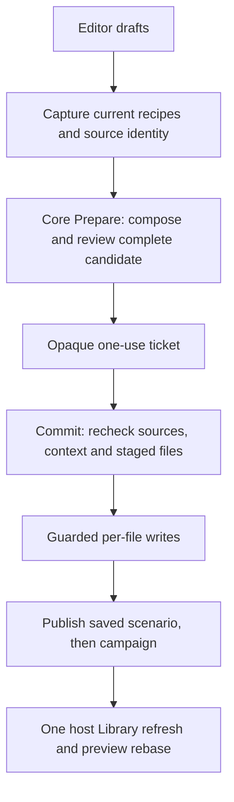

# WCC connection guide

Start here when following an edit through the application. Links point to source
files rather than line numbers so they survive ordinary maintenance. The tables
describe responsibilities, not interchangeable implementations.

## Application and editor ownership

[Program.cs](../src/Wcc.App/Program.cs) and
[App.axaml.cs](../src/Wcc.App/App.axaml.cs) hand window/file routing to
[WmlEditorApplicationController](../src/Wcc.App/Services/WmlEditorApplicationController.cs).
It opens either the application shell or the independent WML editor, and owns their
file-open/shutdown coordination. Campaign RAW windows are separate from that independent
editor registry.

[AppShellViewModel](../src/Wcc.App/ViewModels/AppShellViewModel.cs) wires the project,
Library snapshot, editor sessions, pickers and refresh callbacks together. Its editors are:

| Editor | Responsibility |
| --- | --- |
| [CampaignWindowViewModel](../src/Wcc.App/ViewModels/CampaignWindowViewModel.cs) | Campaign/main.cfg fields and project-level source changes |
| [ScenarioWindowViewModel](../src/Wcc.App/ViewModels/ScenarioWindowViewModel.cs) | Scenario fields, sides, map, events, story and placed units |
| [MainWindowViewModel](../src/Wcc.App/ViewModels/MainWindowViewModel.cs) | Unit **type** editor; the shell owns separate campaign and Library instances |

`MainWindowViewModel` is a historical name, not the shell. `MainWindow` and
`ScenarioWindow` also retain standalone callers. Prefer the existing responsibility-based
partials (`PendingChanges`, `PendingRemoval`, `CollectedSaving`, `Presentation`,
`WmlDefinitionPublication`, and feature-specific editing files) when extending these types.

[ScenarioWindowViewModel.SourceEditing](../src/Wcc.App/ViewModels/ScenarioWindowViewModel.SourceEditing.cs)
owns the shared source-host binding, generation/invalidation checks, loaded-source rebase
and Save-As restrictions. `UsesSourceBackedFieldEditing` prevents unchecked fallback through
the older mutable document fields; it is an ownership guard, independent of engine previews.
`ScenarioSourceSaved` and `SourceLibraryRefreshAsync` connect saved-source publication to
the shell and index refresh.

### Shared loading and unit presentation

[AppShellViewModel.Loading](../src/Wcc.App/ViewModels/AppShellViewModel.Loading.cs)
tracks display-only source-loading leases and registers one Library refresh task before
callbacks can reenter. Broad discovery and
[owned-package refresh](../src/Wcc.App/ViewModels/AppShellViewModel.OwnedPackageRefresh.cs)
share that task slot; later mutations can request another pass. Source/context currency
and Save authority remain with their existing owners.
[Presentation](../src/Wcc.App/ViewModels/AppShellViewModel.Presentation.cs) publishes
`LibraryIndexStatus` text without rerunning pending-change or creation-eligibility work. The shell
owns the busy overlay; embedded Campaign/Scenario views disable their local loading
indicators, while standalone views retain them.

Library unit capabilities publish at the completed source/selection boundary and at
actual session or dirty-state transitions. Animation selection, preview frames and bitmap
completion do not create pending source changes. Real mutations still use the existing
dirty-state path. `MainWindowViewModel.OnSelectedUnitChanged` builds the final local,
variant or inherited animation rows through `ApplyEffectiveChildDisplays`, then selects
the final animation once; it does not first build a temporary local-only list.

[MainWindowViewModel.UnitText](../src/Wcc.App/ViewModels/MainWindowViewModel.UnitText.cs)
and `DisplayUnitId` present literal WML as plain text and encode edits once. `UnitId`,
`UnitTypeDocument.Unit.Id` and catalog `UnitTypeId`/`ExportSymbol` keep their source-facing
representation. `UnitDocVm.DisplayName` and `UnitTypeCatalogEntryVm.DisplayUnitTypeId`
are display adapters, not new lookup identities. Custom/computed source remains RAW.

## WML, macros and resolution

There are three evaluation paths because they answer different questions:

| Question | Start here | Boundary |
| --- | --- | --- |
| What can the editor display from a detached macro invocation? | [WmlMacroExpansionService](../src/Wcc.Core/Wml/WmlMacroExpansionService.cs), [WccLibraryMacroExpansionDefinitionResolver](../src/Wcc.Core/Library/WccLibraryMacroExpansionDefinitionResolver.cs) | Bounded preview expansion with provenance; unresolved/ambiguous constructs stay explicit. Does not establish runtime activation or permission to edit. |
| What does this exact captured source produce in a declared context? | [WccStaticSourceCapture](../src/Wcc.Core/Library/WccStaticSourceCapture.cs), [WmlStaticEvaluator](../src/Wcc.Core/Wml/WmlStaticEvaluator.cs), [WmlStaticEvaluation](../src/Wcc.Core/Wml/WmlStaticEvaluation.cs) | Ordered includes, definitions and preprocessor state over captured inputs. Completeness and exact authored origins matter; output alone grants no write authority. |
| What does the installed engine preprocess? | [WesnothPreprocessor](../src/Wcc.Core/Wml/WesnothPreprocessor.cs), [WesnothPreprocessOverlayEvaluator](../src/Wcc.Core/Wml/WesnothPreprocessOverlayEvaluator.cs) | External engine execution, including paired baseline/candidate overlays where requested. Generated WML is evidence, not the editable original. |

The preview resolver searches the current source revision and pinned dependency levels;
it preserves ambiguity rather than silently choosing a runtime definition. Local definitions
can be supplied directly to the expansion service. `WmlStandaloneMacroPreviewExpansionService`
adds its own detached-preview policy and is intentionally a separate wrapper.

Complete campaign-sized evaluations share `WmlStaticEvaluationLimits.Campaign` in
[WmlStaticEvaluation](../src/Wcc.Core/Wml/WmlStaticEvaluation.cs): 64 × 1024 × 1024
UTF-16 output characters, 128 × 1024 × 1024 source characters, four million steps
and expansion depth 32. Catalogs, editors, unit workflows and fresh Save reviews use
the same immutable policy. It is a ceiling, not an allocation made up front; smaller
detached checks keep their own limits. Exceeding a limit still withholds complete
validation and cannot turn an inspection receipt into permission to save.

[WmlEffectiveDocumentProjector](../src/Wcc.Core/Wml/WmlEffectiveDocumentProjector.cs)
builds effective display documents, including inherited values, while retaining origin
information. An inherited preview and a local authored assignment are different edit targets.

An opened working project without a configured add-ons directory uses its exact
selected dependency closure as the session's virtual add-on namespace. Optional
conditions can prove an unselected mount absent without reading sibling folders.
Unavailable or unidentified pinned sources retain uncertainty. Physical configured
namespace receipts remain separate, and detached read-only captures do not invent
a session namespace. Candidate capture and fresh Save review use the same policy
and include its identity in the ordinary membership evidence.
[Scalar projection](../src/Wcc.Core/Wml/WmlStaticScalarProjection.cs) keeps a stray
closing brace inside its scalar statement. Unsupported brace-containing values
remain unresolved without consuming later fields or scenario boundaries. An
unmatched opening invocation retains the existing structural refusal.
`ConfigureScenarioEvaluationPlan` in the shell connects the campaign and its contexts to
the scenario editor. [WmlCapturedCampaignEvaluationPlan](../src/Wcc.Core/Wml/WmlCapturedCampaignEvaluationPlan.cs)
derives metadata from an exact evaluated menu; the scalar/static editing paths use that
context information rather than guessing that every preprocessor branch is active.

### Campaign entries and contextual membership

One opened add-on remains one project, package, pending queue and dependency-source
session even when its ordinary game menu contains several campaigns or chapters.
[WccCampaignEntryCatalog](../src/Wcc.Core/Campaigns/WccCampaignEntryCatalog.cs) observes
that menu from the immutable package capture. Each entry retains its exact physical
owner and authored span, campaign ID, define, extra defines and difficulty plan.
Reached included menu files are supported; tooling-only menus are not ordinary entries.
Entry identity is separate from the preprocessing cache key: two entries can use the
same symbols while still requiring a navigation change.

A missing include before the menu can temporarily leave its owner span unresolved.
When the exact current capture becomes an ordinary single-entry campaign again,
[scenario mode recovery](../src/Wcc.App/ViewModels/AppShellViewModel.OrdinaryCampaignScenarios.cs)
retires the old inspection rows and restores the ordinary source plan and loader.
Current source/selection checks and pending drafts still govern publication; this
does not promote incomplete membership into edit authority.
[WccCampaignScenarioCatalog](../src/Wcc.Core/Campaigns/WccCampaignScenarioCatalog.cs)
evaluates the existing captured source in each entry's declared difficulties and
records reached scenario owners with their origins. Membership is many-to-many, not
a directory or ID lookup. Repeated sidebar rows share one `ScenarioFileAsset`; several
scenario roots in that file retain distinct selected documents. `DisplayScenarioSpan`
binds a physical literal opening to its imported document, including when a helper
closes and amends that scenario. It supplies display identity, not write permission;
`AuthoredScenarioSpan` retains its stricter writer requirements. Generated macro-body
owners keep source inspection without borrowing a template as an editable document.

| Responsibility | Connection point |
| --- | --- |
| Menu catalog, selected entry fields and entry-change requests | [CampaignWindowViewModel.Entries](../src/Wcc.App/ViewModels/CampaignWindowViewModel.Entries.cs) |
| Membership refresh, grouped rows and synchronized entry/scenario navigation | [AppShellViewModel.CampaignEntries](../src/Wcc.App/ViewModels/AppShellViewModel.CampaignEntries.cs) |
| Exact current row and physical-source reload selection | [AppShellViewModel.ScenarioNavigation](../src/Wcc.App/ViewModels/AppShellViewModel.ScenarioNavigation.cs) |
| Shared source plus per-entry owner/context row | [ProjectScenarioFileVm](../src/Wcc.App/ViewModels/Wcc/ProjectScenarioFileVm.cs) |

The shell applies the existing Save/Discard/Cancel barrier before publishing a
matching campaign, scenario and difficulty selection. Cancel, failed Save and a newer
request preserve the accepted selection. Entry switching keeps the package session
and manual source attachments. `WaitForCampaignEntriesAsync` drains both campaign
field projection and the resulting membership publication; awaiting an earlier
membership task alone is insufficient after a source refresh.

[ScenarioWindowViewModel.CapturedEvaluation](../src/Wcc.App/ViewModels/ScenarioWindowViewModel.CapturedEvaluation.cs)
connects complete ordinary membership results to scenario field display. Navigation
can reuse the catalog's exact evaluation and scalar projection for the selected
difficulty instead of preprocessing the package again for each scenario. The binding
checks the catalog, membership occurrence, plan, snapshot/root revision, physical
source bytes and span, visible revisions, profile and source folders. Host-state
checks happen before work and again before publication. A membership refresh revokes
the old binding; a missing or incompatible receipt uses the existing evaluation path.
The lazy per-context adapters share existing graphs and resource evidence rather than
retaining another expanded copy. This is display reuse through the same evaluator,
not a second evaluator, an inspection upgrade or permission to skip fresh Save review.

Navigation publication also rechecks the current project, catalog, snapshot,
navigation request, selected entry and row after callbacks which can navigate again.
An older operation stops rather than restoring its stale row over the newer selection.
`RevokeCampaignScenarioEvaluation` explicitly revokes receipts when membership resets;
an invalid or delayed binding request cannot clear a newer valid receipt. These
guards are covered by deterministic cancellation and load-callback reentrancy tests.

Project unit storage remains shared, but a complete selected entry/difficulty
observation filters literal unit rows by exact physical owner, source text and span.
This distinguishes mutually exclusive same-ID definitions, such as AtS's Sylvan
Warden variants. Partial evaluation cannot prove a unit absent and does not filter it
out. It also cannot grant editing or select an arbitrary runtime definition.
Project-unit editing under the selected adapter additionally requires a fresh,
complete ordinary membership result for that exact selected entry and current
catalog. `RequiresSelectedCampaignUnitInspection` keeps the unit editor read-only
when only the menu or bounded scenario inspection is complete. Available images
and retained scenario previews do not replace full gameplay evidence or the usual
unit ownership/save guards.

For a project-unit update,
[AppShellViewModel.UnitTypeUpdating](../src/Wcc.App/ViewModels/AppShellViewModel.UnitTypeUpdating.cs)
captures from `State.Plan.CampaignMainSourcePath`, the real package root, while
`State.Source` remains the selected physical menu file. The Core
[unit-update validator](../src/Wcc.Core/Scenarios/WccScenarioFieldStaticReviewer.UnitTypeUpdate.cs)
compares that staged capture's root with the independently fresh capture's root.
It does not require an included menu to be the entrypoint. The ordinary selected
menu-owner proof, unit-source evidence and root units-container checks remain.

[WccSelectedCampaignEntryAdapter](../src/Wcc.Core/Campaigns/WccSelectedCampaignEntryAdapter.cs)
now presents a complete selected campaign to the ordinary editing workflow. Its
`RootSource` remains the real package entrypoint, with the actual include order and
captured dependencies. `OwnerSource` and `Menu.Source` identify the physical file
containing the selected campaign declaration; an included menu's
`EvaluationEntrySource` still identifies the real root. The adapter never flattens
expanded output or creates a synthetic single-campaign file to persist.

The binding removes the campaign-count and included-menu policy locks. Existing
field routes and recipe validators decide which operations are supported: direct
tokens, proven macro arguments, insertion/removal, difficulty conversions and the
ordinary structured recipes retain their own ownership and layout requirements.
There is no second list of permitted field names. Generated owners, uncertain
winning assignments and incomplete selected contexts keep their source/RAW fallback.
An included menu does not make a root-oriented creation/storage planner compatible
with every package layout; a planner must still prove its genuine root/include target.
A collected batch with separate menu and scenario requests for the same physical
file remains refused before writing rather than merging their ownership implicitly.

An explicit
[WccCampaignEntryReviewIntent](../src/Wcc.Core/Scenarios/WccCampaignEntryReviewIntent.cs)
binds the real root and selected entry identity. It is an expectation to authenticate
again during Prepare, not write authority. The ordinary
[Project reviewer](../src/Wcc.Core/Scenarios/WccScenarioFieldStaticReviewer.Project.cs)
uses the existing validators, composer and coordinator for collected typed edits.
Selected-entry proposals do not use the direct single-context saver. The former
`ScalarFields` mode, field whitelist and separate `PackageScalar` proof have been
removed. Ordinary single-entry main-file workflows keep their existing route.

Prepare evaluates the real menu and the selected campaign's declared difficulty
scope before and after the candidate. Other campaign declaration subtrees are
excluded from selected-menu semantic comparisons while common root state, source
mappings and invocation evidence remain. The selected target, winning value,
operation bounds, unrelated output/history, translation-domain state and source
closure still have to pass the ordinary proof. Invalid sibling gameplay does not
block a selected campaign's Save. Edits to shared files or helpers may affect other
campaigns; the shell gives a nonblocking advisory rather than requiring sibling
validation or proof of no effect. This workflow provides no package-wide validity
guarantee, and it cannot ignore a blocking common-root or selected-context failure.

[Selected-entry review](../src/Wcc.Core/Scenarios/WccScenarioFieldStaticReviewer.SelectedEntry.cs)
reuses complete scalar-owner bounds when masking sibling campaign declarations.
The fast path requires the projection's exact evaluation, an authenticated root
campaign target, unamended mapped opening/closing boundaries and complete tag lines.
It compares existing owner keys only among root campaign candidates. With no sibling
to mask, it returns the original evaluation and projection. Otherwise it retains the
normal equal-length mask, invocation/source mappings and scalar re-projection.
Unsupported, fragmented, amended or stale boundaries keep the previous complete
parser fallback. No output is deduplicated and no write obligation is omitted.

[WccSourceSaveDiagnostics](../src/Wcc.Core/Scenarios/WccSourceSaveDiagnostics.cs)
records this work under `SelectedCampaignScoping`, with fast-path, fallback, no-op
and selected-mask projection counters. Selected-mask projections also participate
in the ordinary scalar-projection timing/counts; older reports did not count that
extra projection. Compact owner-comparison attempt/success/fallback counters expose
its existing size-budget cliff without changing that algorithm or budget. New enum
members append to existing values so stored diagnostic receipts retain their numeric
meaning. Timings are inclusive and nested phases must not be added as disjoint work;
telemetry grants no persistence authority.

**Edit scenario WML** retains its separate whole-file draft contract for an exact
physical scenario source. Main/menu files and generated ownership remain excluded.
**Apply** stages text without replacing the pristine loaded baseline or preview;
Save/Discard/Cancel navigation and pending-row removal use the existing shell queue.
The [RAW reviewer](../src/Wcc.Core/Scenarios/WccScenarioFieldStaticReviewer.PackageRaw.cs)
uses the same selected-entry binding and selected difficulty scope while retaining
its disjoint source footprints and amended-owner support. Whole-file package RAW
drafts cannot be mixed with other editor drafts. Display anchors and RAW text do
not authorize persistence: checked one-use tickets, native freshness guards and
current source/context publication checks still govern every write.

[AppShellViewModel.PackageRawEditing](../src/Wcc.App/ViewModels/AppShellViewModel.PackageRawEditing.cs)
captures the selected scenario source and revocable proposal;
[AppShellViewModel.CollectedSaving](../src/Wcc.App/ViewModels/AppShellViewModel.CollectedSaving.cs)
collects ordinary typed edits through the shared coordinator. Successful publication
uses an exact saved-source receipt to rebind the selected physical document while
Save stays busy. The campaign's
[checked-publication scope](../src/Wcc.App/ViewModels/CampaignWindowViewModel.SelectedEntryPublication.cs)
also refreshes its committed menu view before that busy state ends; only the exact
own-commit receipt admits this refresh, without enabling user edits. Once campaign
field projection settles, `CampaignFieldProjectionPublished` refreshes the scenario's
selected source binding even when the menu catalog was reused. That binding update
does not require another membership build. The subsequent fresh capture invalidates
all old membership receipts
and immediately evaluates the selected campaign. Sibling rows may retain navigation
labels only; opening one rebuilds its membership from the fresh capture before it
can supply fields or edit bindings. Save/Discard/Cancel, newer requests, profile and
snapshot fences remain in force. This is not a measured Save-speed improvement.

The selected-adapter integration is verified in
`artifacts/selected-campaign-adapter-checks/finalcloseout.json` (2026-10-21): Windows
full Core6432/App2524 and focused202/130; offline Linux focused202/130, with no failed
or skipped tests. The receipt binds 1387 frozen compiled inputs, separate platform
outputs and their dependency copies. A fresh Core-only actual AtS check prepares
one included-menu field plus five scenario/side edits in two physical files, using
the menu and three selected difficulties instead of ten package review phases.
It never commits installed sources and is not a rendered App, engine playthrough
or measured full Save-speed result. Preview.4 is unchanged. Earlier all-entry and
scalar-pilot receipts remain historical in `artifacts/campaign-entry-display-checks`,
`artifacts/package-scalar-gui-checks` and `artifacts/ats-editor-followup-checks`.

The current feedback follow-up is implemented and independently verified on
2026-10-21 in `artifacts/adapter-feedback-checks/finalcloseout.json`.
[WccScenarioDifficultyFieldPlanner](../src/Wcc.Core/Scenarios/WccScenarioDifficultyFieldPlanner.cs)
can prove a paired literal side or leader beneath a helper-amended scenario. The
target and intermediate side parent retain exact paired boundaries; lexical matching
proves their containment beneath the same physical scenario opening. Captured-owner
equality separately retains the actual closing origin, amendment state and expansion
frames. The ordinary reviewer still checks each selected difficulty's winning
contribution, explicit absence/insertion, candidate value and outside footprint.
Converting the amended scenario root itself, or a generated/amended child, remains
unsupported.

The same follow-up separates local insertion from destructive side topology.
[WccScenarioLeaderAdditionPlanner](../src/Wcc.Core/Scenarios/WccScenarioLeaderAdditionEdit.cs)
supplies the bounded insertion anchor reused by initial-unit placement. An amended
ancestor can contain an exact unconditional local side when a complete captured
projection proves the physical scenario opening and the side's paired authored
boundaries. This does not permit removing/reordering that scenario's sides; the
existing topology planner remains strict. Generated, amended or conditional sides
and uncertain source/projection bindings retain RAW. Neither change turns bounded
scenario inspection into Save authority: full selected-context and unit-registration
proofs, ordinary semantic checks and the existing writer guards still apply.

The shared structural reviewer now accepts output after an amended scenario's first
closing tag only for independently validated `DifficultyField`, `UnitInstance` and
`LeaderAddition` child recipes. Exact source openings, lower bounds, local target
boundaries, parent/footprint checks and final outside-output comparison remain.
This is not a general amended-owner insertion route: RAW, Music and Schedule retain
their stricter region bounds.

The AtS feedback follow-up changes RAW composition to disjoint changed-line
footprints in
[PackageRawDiff](../src/Wcc.Core/Scenarios/WccScenarioFieldStaticReviewer.PackageRawDiff.cs).
Changing turns, a nested side's gold and a later leader name no longer masks every
unchanged tag and invocation between those edits. The composer must reconstruct the
exact proposed file from its separate pristine-source patches. Each changed footprint
still refuses preprocessor directives, and the current menu/selected-difficulty,
outside-output, source-history, translation-domain, context, closure and native writer
checks remain. Diff work is bounded at 128K physical lines per source version and 4M
frontier/search operations; an excessive rewrite is refused rather than receiving a
broader mask. The verified follow-up is recorded in
`artifacts/ats-feedback-checks/finalcloseout.json`.

Large or unsupported contexts retain diagnostics and an **Unresolved membership -
source only** group. A typed output-character-limit failure can additionally request
the separate [scenario inspection catalog](../src/Wcc.Core/Campaigns/WccCampaignScenarioCatalog.Inspection.cs).
Its [inspection receipt](../src/Wcc.Core/Wml/WmlScenarioInspectionResult.cs) distinguishes
complete retained scenarios from complete package evaluation. Every included source
still executes in order. Before include aggregation, the inspection evaluator omits
completed unit-type interiors while retaining exact mapped boundaries and active
translation-domain directives. Final output must prove every omitted occurrence is a
direct child of root `units`; ambiguous, quoted or scenario-nested occurrences refuse.
Computed names, arguments and defaults remain ordinary value buffers until emitted.

The full `16 * 1024 * 1024` output-character limit is unchanged. A single source can
still overflow before inspection can omit its unit interiors. Source, processing,
depth and separate inspection-inventory limits remain bounded. The receipt's ordinary
`Evaluation.IsComplete` is always false: it cannot prove unit values or absence,
replace full RAW review, or authorize saving. Read-only fields, Story, Map/Events and
active image paths use explicit inspection adapters under the selected entry, source,
profile, snapshot and difficulty bindings. Normal full-evaluation routes stay separate.
Nonblocking advisories remain visible; blocking diagnostics still prevent completeness.
This is not validation of omitted unit attributes or runtime unit events. The shared
statement-aware lexer keeps image ranges such as `[1~3]` and variable indexes out of
tag ownership. Theme widgets named `unit_type` retain their full captured content.

Successful `#warning` and `#deprecated` directives retain their diagnostics and source
origins without entering emitted WML, so advisory metadata cannot split an inline
scalar helper. Malformed directives still emit unresolved text and block evaluation.
The inspection tag pass shares the editor's tag readers without allocating its
presentation tokens, folds or references; its separate tag and processing bounds remain.

The installed LotI beta now yields 95/115 reached scenarios across both entries and all
six difficulty contexts through this read-only route. AtS's nine ordinary full contexts
and retained views match the same 55 scenario mappings and field values. Windows full
Core6379/App2489 and offline Linux focused Core262/App326 pass; source, binaries, original
files and exact mappings are bound by `artifacts/loti-scenario-inspection-checks/finalcloseout.json`.
This evidence does not turn omitted units or retained scenarios into write authority.

Opened campaign units reuse this same inspection for image search when their ordinary
full display scope reaches the output limit. `UnitDisplayScope` computes it off the UI
thread once per captured package/context; it does not replace the full unit projection.
The image adapter accepts the exact complete captured Core-unit prelude, while foreign
copies remain invalid. Changed-source drafts cannot borrow the unchanged baseline's
inspection. Sprites, portraits and animation frames continue through the existing
shared image context. Evidence: `artifacts/unit-campaign-image-checks/finalcloseout.json`.

### Managed dependency and chapter authoring

One package/project retains its real source closure and selected-campaign adapter.
New packages use authoring layout 2: every chapter, including the first, has a
`chapters/<id>/scenarios` directory. Menu and gameplay registration remain bounded
owned blocks in the real package main. Units, utilities, maps and assets remain
shared storage; evaluated activation still determines their visibility. Removing
registration retains the underlying files. Older layout-1 projects retain ordinary
editing, dependency management and scenario creation; adding a chapter requires the
new layout or RAW editing. No automatic file migration runs on opening a project.

The four-page creator uses one chapter model/editor for the required first chapter
and additional chapters, including presentation images and difficulties. Its final
page contains dependencies. The later Add Chapter dialog reuses that editor, with
reference-only menu images until the package transaction supports binary creations.

Each dependency has an explicit ordered activation recipe: asset binary paths,
source includes/macros, defines and campaign resource loads, with menu, gameplay or
campaign-child phases. The folder questionnaire applies an evidenced suggestion for
new recipes and preserves intent when reopening an existing recipe. Attached sources,
optional download requirements and runtime loading remain separate concepts.

Portable recipes and ownership receipts share `.wcc/package-authoring.json`.
Readable dependency markers use the add-on ID; loaders use
`loaders/<AddonId>_loader.cfg` and phase-specific `WCC_DEP_<AddonId>_*` wrappers.
Full private identities, recipe hashes and file hashes stay in the companion.
Readable source names are locators, never sufficient ownership evidence. Missing or
changed receipts retain RAW. Earlier development-only inline/compact formats are
not adopted automatically. Only the fixed companion JSON enters ordinary capture.

The public companion contract is `schema: "wcc.package-authoring"`,
`schemaVersion: 1`. A positive `generatorVersion` records the emitting generation
without changing schema compatibility. Dependencies, chapters and owned-file
receipts share one document so changing one area preserves the others. Optional
root properties survive edits; unknown nested structure requires a compatible
reader instead of being discarded. Duplicate JSON properties, unsupported schemas,
escaping paths and portable filename collisions are refused. Opening never rewrites
the companion. Future incompatible schema changes require a supported reader or an
explicit checked upgrade that preserves the original project on failure; existing
identities and emitted difficulty symbols must remain stable. The frozen schema-1
fixture in `WccPackageAuthoringManifestTests` is the compatibility baseline.

Keep the complete `.wcc` folder when sharing editable projects. `project.json`
contains stable project identity, Core compatibility and selected library bindings;
`package-authoring.json` contains portable loading/topology intent and owned-file
receipts. Neither substitutes for freshly captured WML, source identity or the
normal checked transaction. An owned-file receipt makes that exact file a cleanup
candidate; it does not permit deleting unknown files found by an orphan scan.

Cleanup is a first-class operation in that same transaction. Reviewed removal
candidates retain exact current disk identities and bytes through staging and
commit. Text ownership survives ordinary edits; binary cleanup requires the stored
byte hash, and references outside the removed chapter preserve shared resources.
Windows removes a file through its verified handle. Linux moves it out of the
active source namespace with a checked, non-replacing rename and retains verified
recovery copies with an explicit cleanup warning. No post-Save pathname deletion
or global orphan sweep grants additional authority.

`WccCampaignPackageEdit` composes chapter/dependency intent into the existing source
request, candidate namespace, reviewer, collected coordinator and atomic writer.
Fresh capture rebuilds the same plan. Existing revision, destination, outside-source,
context, one-use ticket and staged-byte guards remain. Checked publication also
handles a loader/metadata edit whose root main bytes do not change; it reacquires
captured companion data instead of reusing the old root-only catalog. Imported
unmarked dependency loading and chapter topology remain RAW; new managed dependency
blocks require an exact supported insertion boundary and do not adopt old code.

Dependency audio choices use the same captured binary-path order as image lookup.
The read-only App `WccDependencyAudioScope` checks the exact active provider and
resource precedence. `WccStaticSourceCapture.EnumerateCapturedResourceMembers` exposes
frozen file membership without walking directories from a picker. For a new empty
chapter, `WccCampaignScenarioCatalog.ProjectContext` prepares one declared gameplay
context through the same evaluator initialization used by ordinary scenario
membership; it does not create another resolver or persistence route.

The Campaign dependency and chapter dialogs stage these same typed recipes for
collected Save. A future resource-author `include.wcc` file could supply the same
recipe; no format or support is implemented.

### Bounded event graph and authored RAW events

[WccScenarioEventGraph](../src/Wcc.Core/Scenarios/WccScenarioEventGraph.cs) describes
one ordered action chain. The selectable triggers are start, prestart, victory,
turn number, death of a literal unit ID, and entry into a coordinate filter.
Actions are message, move unit, end scenario with victory or defeat, Spawn Unit,
Wait, Scroll camera and Adjust gold. Wait requires positive milliseconds; camera
movement requires positive X/Y; gold requires an explicit positive side and signed amount.
[WccScenarioEventGraphEditor](../src/Wcc.Core/Scenarios/WccScenarioEventGraphEditor.cs)
classifies and patches the supported literal source; it uses the shared WML
analysis and human-text codec rather than another evaluator. Unchanged captured
source returns exactly, including comments, line endings and translation contexts.
Exact scoped saved Unit calls within Spawn actions and declared difficulty guards
have bounded capture support. Other unsupported tags, fields, helpers, runtime
expressions and control structures retain RAW editing rather than being flattened.

[EventNodeGraphWindowViewModel](../src/Wcc.App/ViewModels/EventNodeGraphWindowViewModel.cs)
and [EventNodeGraphWindow](../src/Wcc.App/Views/EventNodeGraphWindow.axaml) own the
detached canvas, compact cards, palette, selected-node settings and connections.
Connections determine execution order, and Arrange lays the chain out horizontally.
Resizable difficulty regions have no execution ports. Whole-card containment assigns
explicit action-key membership; Core requires a consecutive chain interval, disjoint
siblings or strict same-difficulty nesting, and actual declared difficulty symbols.
Crossings, partial cards and disconnected actions block Apply until repaired. Removing
a region keeps its actions. WML stores whole-action `#ifdef`/`#endif` guards, not canvas
geometry. Node keys retain source identity in memory and are never emitted as WML IDs,
hashes or layout comments. The optional native event
ID is separate and is locked when editing a captured event. The host's duplicate-ID
feedback covers known events in the current scenario context, not dynamic runtime
handlers or every other context.

Spawn reuses [UnitPlacementWindowViewModel](../src/Wcc.App/ViewModels/UnitPlacementWindowViewModel.cs)
through [EventSpawnUnitEditor](../src/Wcc.App/ViewModels/EventSpawnUnitEditor.cs) and
[EventGraphUnitPicker](../src/Wcc.App/Views/EventGraphUnitPicker.cs). It keeps exact scoped
saved Unit references and local overrides, including nested uses in Event presets;
it does not copy expanded preset output. The Event region owns difficulty. Scenario
hosts supply captured side choices and the existing map picker; detached preset forms
require an explicit numeric side. Known unit IDs are suggestions, not runtime-existence proof.

[ScenarioWindowViewModel.WccDialogueGraph](../src/Wcc.App/ViewModels/ScenarioWindowViewModel.WccDialogueGraph.cs)
retains its historical filename but hosts the same generic event proposal. Apply
stages through the existing event draft, exact source planner, collected pending
changes and checked Save coordinator/native writer. It does not write from the
canvas. Local detached validation is cached until the graph changes; source review
still runs at Apply and again through the ordinary Save. Host, source, difficulty,
selection and related draft changes revoke an old proposal. The map picker reuses
the detached coordinate dialog and checks the same map/model/draft before and
after awaiting it; the graph also rejects stale selected-node or callback results.

[WccScenarioEventWorkspaceView](../src/Wcc.App/Views/Controls/WccScenarioEventWorkspaceView.axaml)
exposes Add Event/Edit Event beside Add WML/Edit WML. Direct events use the exact
authored block. Macro-generated groups keep the original invocation and its
existing whole-group source restrictions. Displayed native/preprocessed output
never becomes an editable original. An end-scenario action does not change the
scenario's automatic victory setting. Direct events and scoped Event presets use
this same graph, typed source recipes, reviewer and collected Save workflow.

The map and event editing workspace can use different projections.
`PublishMapPreviewRetainingAuthoredEvents` in
[ScenarioWindowViewModel.WccEventDrafts](../src/Wcc.App/ViewModels/ScenarioWindowViewModel.WccEventDrafts.cs)
retains the independently authored event rows while publishing an evaluated map.
Both the native-map path and the selected-campaign captured-map path use this boundary.
Ordinary captured-map refresh retains the authored list through its complete,
unconditional coverage check. Graphs with supported internal difficulty regions also
require the exact current capture, physical event coverage and current-difficulty canonical output
proof in [CapturedInitialMap](../src/Wcc.App/ViewModels/ScenarioWindowViewModel.CapturedInitialMap.cs).
Neither row counts nor rendered output grant source identity or write permission.
Unproved cases retain the captured active-context event list as read-only display.
Existing source binding, membership and freshness checks still authorize every edit;
reentrant context changes retire the old retained view without clearing a newer one.

### Captured Story, event and map previews

The AtS feedback follow-up is implemented and verified. It reuses
the exact selected physical scenario and complete captured difficulty projection;
display ownership remains separate from the strict authored writer span.
[WccScenarioStoryPlanner.CapturedPreview](../src/Wcc.Core/Scenarios/WccScenarioStoryPlanner.CapturedPreview.cs)
joins macro-provided parts and their fields to a read-only Story snapshot, including
amended Naia scenarios. Part/field editing and topology operations stay disabled.
[ScenarioWindowViewModel.WccStoryEditing](../src/Wcc.App/ViewModels/ScenarioWindowViewModel.WccStoryEditing.cs)
publishes that snapshot without replacing the authored macro invocation.

The ordinary Story preview now falls back to that same read-only route when a
helper closes or amends an otherwise exact physical scenario. Failure to prove the
scenario's writable closing extent cannot establish that its Story is absent:
captured macro slides remain visible, while unproved field and topology editing
stay disabled. A genuine absent Story in an exact ordinary scenario retains the
existing creation workflow. This fallback is verified by
`artifacts/selected-campaign-adapter-checks/finalcloseout.json`.

The read-only route also retains a complete slide whose title uses literal string
concatenation, as AtS title cards do. Exact captured expressions stay in `RawValues`;
separate immutable display values join bounded literal operands in source English.
The observer is limited to 128KiB and 256 operands and performs no locale lookup,
interpolation, formulas or Lua. Unsupported expressions retain their raw source and
an unavailable display diagnostic. `StoryFieldVm` consumes these read-only display
values without changing its raw draft representation or edit guards. The strict
scalar, resource-value and writable Story codecs remain unchanged.

[WccCapturedScenarioPreview](../src/Wcc.Core/Scenarios/WccCapturedScenarioPreview.cs)
feeds the existing event and spatial classifiers a bounded detached representation of
the exact captured owner. Ordinary child blocks retain their captured action ordering,
opaque Lua and dynamic coordinate expressions. These are possible effects, not a
simulation of which events fire or where a runtime expression eventually places a
unit; Lua is never executed. Initial units with exact coordinates can be located,
while dynamic or missing components stay unresolved. The published rows deliberately
discard authoritative source lines, direct-event ordinals and macro edit provenance;
they cannot be used to write the detached representation back.
[ScenarioWindowViewModel.CapturedInitialMap](../src/Wcc.App/ViewModels/ScenarioWindowViewModel.CapturedInitialMap.cs)
replaces inspection overlays only under the current source/owner/context/generation
checks. Ordinary editable scenarios retain their existing authored mappings.

The prior schedule display follow-up is independently verified on 2026-10-21 in
`artifacts/adapter-feedback-checks/finalcloseout.json`.
[WccCapturedScenarioSchedulePreview](../src/Wcc.Core/Scenarios/WccCapturedScenarioSchedulePreview.cs)
reads the same exact physical scenario from a complete full projection or an explicit
complete scenario-inspection receipt. It shows direct initial `[time]` owners after
amendments, including their final RGB values. It does not run prestart/event actions
or Lua, and its serialized display blocks have no editable source ordinals. Both the
receipt and its schedule projection deny composition/persistence authority.

[ScenarioWindowViewModel.WccCapturedSchedule](../src/Wcc.App/ViewModels/ScenarioWindowViewModel.WccCapturedSchedule.cs)
binds those rows to the current scenario, source text, owner, difficulty, generation
and captured image context. This display replaces an unavailable or different
fragment timeline; a matching ordinary authored schedule keeps its existing editing,
selection and pending-draft behavior. Image lookup reuses
[WccCapturedImageResourceContext](../src/Wcc.Core/References/WccCapturedImageResourceContext.cs)
and checks the image's captured definition/caller source hashes before resolving it.
Old display closures cannot publish across a changed context or source.

For fragment and picker thumbnails,
[WccScheduleImagePreviews](../src/Wcc.App/ViewModels/Wcc/WccScheduleImagePreviews.cs)
authenticates each value origin before comparing physical package/file identities.
Nested macros in one exact file can therefore contribute one image expression;
missing, stale or mixed physical origins still refuse. The prior verified slice
showed the base image without rendering image modifiers.

That slice retained the detached music/schedule composers' chronology limits:
isolated AtS `MAP` needed its active `ME` binding, and LotI `GLOBAL_EVENTS` depended
on its actual environment. A readable captured schedule did not itself unlock
authoring. The new captured-authoring path below addresses bounded cases without
changing that display receipt's authority.

Those historical feedback receipts record Windows full Core6452/App2533, Windows focused
535/172 and offline Linux focused535/172, all passing. The read-only Core checks in
`artifacts/adapter-feedback-checks/actual-ats-r1/report.json` pass 26 assertions:
AtS I01/I03/I12 expose 15/15/1 effective initial slots with 31 resolved image paths;
two public Prepare calls accept I01 side income conversion and initial-unit addition,
without Commit or native writes. The LotI report in `actual-loti-r1/report.json`
passes 13 assertions and resolves Twilight's six time images. LotI's ordinary full
evaluation still reaches the existing output-character limit, so its inspection
remains read-only even where local music/time source looks conventional. These
reports do not establish actual App rendering, image-modifier rendering, engine
playthrough or end-to-end Save performance.

### Captured initial settings and local image crops — verified

`artifacts/music-schedule-authoring-checks/finalcloseout.json` verifies the 1409
frozen inputs: Windows full Core 6497/App 2550 and focused Core 720/App 293 on both
Windows and Linux, with no failures or skips. Actual read-only AtS/LotI checks and
the App bitmap/crop probe pass 24/13/42 assertions. The prior receipts above remain
historical evidence. These routes apply equally to WCC-created and imported campaigns.

[ScenarioInitialSettingsCapturedContext](../src/Wcc.Core/Scenarios/ScenarioInitialSettingsCapturedContext.cs)
is internal planning evidence from a complete full evaluation of the exact physical
scenario. The music and schedule editor overloads use its actual mapped invocation
footprints and active physical definitions, preserving include/define chronology
instead of probing unrelated helpers in isolation. Whole time owners and every
starting-time contribution must be represented. Unknown, mixed or amended slot
ownership and replaced fragments with include, define, undef or textdomain effects
remain unsupported. A bounded scenario inspection is never an authoring context.

The App's
[captured-authoring partial](../src/Wcc.App/ViewModels/ScenarioWindowViewModel.WccCapturedMusicScheduleAuthoring.cs)
keeps a viable ordinary source recipe when it represents the same playlist or
schedule. It selects captured authoring when the ordinary route is unsupported or
the actual captured result differs. A captured refusal alone does not override a
viable matching ordinary route. Positive captured evidence of additional initial
music outside the represented playlist is a separate typed conflict: the editor
refuses that misleading partial playlist rather than showing it as editable.
Whichever route is selected, the App keeps its original recipe and full projection
while drafts are pending.
`WccScenarioInitialSettingsEdit.WithCapturedProjection` carries that planning input
when required into the existing shared composer; `ComposePreview` supplies candidate display only.
The candidate schedule preview denies composition/persistence authority. Mixed
music, schedule, field, flag and event drafts still use the ordinary collected Save.

The music picker already distinguishes direct references from copying. Core Campaign
and WCC tracks go through `AddWccMusicSelectionsAsync` and
[WccPackageMusicImporter](../src/Wcc.Core/References/WccPackageMusicImporter.cs),
which copies/reuses exact bytes under the campaign's `music/` folder and returns its
relative name for WML. Core tracks remain references. The actual AtS I04
`decoherence.ogg` has a campaign-local copy matching the TDG source bytes; AtS's
active own binary path makes that relative name accessible. This does not rely on
TDG's private binary path being active. Imported assets remain after playlist
Discard, as the existing picker contract states. Asset lookup follows the
[engine binary-path rules](https://wiki.wesnoth.org/BinaryPathWML).
This particular AtS result does not prove generic imported-project activation:
copying a track alone does not establish an active project music path or resolve
filename shadowing by another active path. That emitted-lookup proof remains a
separate follow-up.

Core 1.19.28's `data/core/macros/schedules.cfg` already defines
`TWO_SUNS_DEFAULT_SCHEDULE` and `DEFAULT_SCHEDULE_DUSK`. AtS's contained Naia
explicitly undefines and replaces the two-sun macros, including different atlas
images. Catalog availability and the active physical definition are therefore
separate: a matching name cannot justify displaying the Core version in place of
the selected campaign's reached definition.

The [Project reviewer](../src/Wcc.Core/Scenarios/WccScenarioFieldStaticReviewer.Project.cs)
rebuilds original and candidate recipes from fresh evaluations in each selected
declared context. Its
[music/schedule validation](../src/Wcc.Core/Scenarios/WccScenarioFieldStaticReviewer.MusicSchedule.cs)
checks the requested tracks, complete time shapes and starting choice before the
normal outside-output, history, source-closure and writer checks. An unchanged
custom finish call is preserved only when its exact physical active definition
matches the supported Core template and both evaluations prove the same initial
music target. Paired normalization of that unchanged call is comparison evidence;
the helper is not rewritten or granted a new edit route. When other edits shift an
unchanged helper in the same file, the private validator rebinds its original exact
definition range through the shared candidate mapping and derives its candidate
start line. It refuses changed definition text or an unprovable mapping rather
than matching a same-named helper elsewhere.

Unproved footprints, unsupported finish plumbing, mixed or amended time effects,
stateful replaced calls and incomplete full evaluation retain RAW access. In
particular, LotI's complete read-only inspection does not bypass its ordinary full
output limit. No engine actions or Lua are executed by these planners.

[WccImageExpressionCrop](../src/Wcc.Core/References/WccImageExpressionCrop.cs)
and the shared [BitmapFileLoader](../src/Wcc.App/Preview/BitmapFileLoader.cs) add a
bounded local preview for complete literal `~CROP(x,y,w,h)` chains. Schedule rows
and picker options retain the exact image expression beside the authenticated
resolved path. Fully in-bounds crops are composed left to right and decoded in
memory; unsupported or mixed modifiers, clipping and oversized local decodes keep
the base-image fallback. This does not add a general image-modifier editor, resource
lookup, temporary file, engine invocation or authoring permission.

The scalar projection separately retains internal parsed output bounds for display
copying. A macro can assemble a valid child header, or an amendment can create a
logical child, without proving an exact mapped authored opening. The captured
preview may copy that complete parsed child, including its opaque payload, while
the public source origin, occurrence offsets and writer routing stay unchanged.
The same parsed tree must remain structurally known and within the existing
4096-node, 128-depth and 2 * 1024 * 1024 output-character preview bounds. Amended
owners that need reconstruction still require exact final captured assignments.
These display bounds do not establish source-edit anchors or give a detached child
a fabricated ordinal. The display correction is verified in
`artifacts/ats-editor-followup-checks/finalcloseout.json`.

The subsequent schedule feedback slice is verified in
`artifacts/schedule-feedback-checks/finalcloseout.json`. It retains original
image-slot provenance across repeated/reordered pending times and Save, permits
only balanced lexical textdomain switches when materializing literal time blocks,
and removes otherwise-empty owned time lines without consuming comments or
unrelated gaps. Picker observations select the exact reached physical definition;
multiple observed definitions stay ambiguous. These changes retain the existing
fresh selected-context reviewer and do not promote LotI's bounded inspection into
write authority or raise the ordinary full-output limit.

[WmlStaticScalarProjection](../src/Wcc.Core/Wml/WmlStaticScalarProjection.cs) observes
bounded literal numeric `side,color` pairs on sides and `x,y` pairs on supported
side/leader/image/unit owners, retaining each exact component's contribution.
[WmlCoordinateValueText](../src/Wcc.Core/Wml/WmlCoordinateValueText.cs) is shared by
coordinate inspection: `x,y="6","15"` supplies two literal coordinates, whereas
`x,y="6,15"` supplies one quoted value and leaves Y missing/unresolved. It splits
outside quotes before decoding, so a comma inside one string cannot manufacture the
second key. This adds no general multiple-assignment editor or typed write route.

### Catalogs, references and resources

[WccPresetFieldImagePreviews](../src/Wcc.App/ViewModels/Wcc/WccPresetFieldImagePreviews.cs)
is the shared asynchronous image preparation route for campaign and preset fields.
UI getters capture immutable requests and a lazy resource context; the preview worker
performs resource projection, lookup, decoding and modifier rendering. Host predicates
and notifications remain on the calling context, with cancellation, request identity
and current-source checks before publication. Disposed or superseded requests cannot
publish an old bitmap. Schedule picker thumbnails likewise defer their projection and
captured-origin work through lazy values consumed on the existing background queue.
These are display routes using the existing resource resolver and renderer, without
new source-edit authority or an assertion that every application operation is async.

Scenario leader sprite lookup can encounter several visible catalog records for
the same type, for example a contained Naia definition in both AtS and IftU. Catalog
visibility alone cannot select the active definition. The scenario preview reuses
the existing captured campaign unit-display scope and complete registration
inventory, selecting one exact active declaration in the current entry/difficulty.
It keeps the selected physical span, inheritance display and current captured image
search order. A local portrait value still takes precedence over this type lookup.
Incomplete registration, several active declarations, unresolved visuals or a stale
source/profile/context return an unavailable preview. Read-only scenario inspection
cannot choose an omitted unit. This adds no resolver, catalog deduplication or write
authority; the shared asynchronous scope is reused, with current-publication checks
before and after awaiting it. The same prior follow-up receipt verifies this display
correction; it does not establish selected-adapter Save verification.

[WccLibraryCoordinator](../src/Wcc.Core/Library/WccLibraryCoordinator.cs) publishes Library
snapshots. `RefreshConfiguredLibraryIndexAsync` in the shell connects publication to
manager adapters, unit lists and assets. Direct entity catalogs and macro-derived preset
catalogs remain distinct: a macro name alone is not a direct entity definition.

[WccProjectCorePinResolver](../src/Wcc.Core/Library/WccProjectCorePinResolver.cs) connects
portable project Core intent to the local index. Existing IDs must still match exactly;
a fully rebuilt index can resolve new IDs only through one matching exact version, target
and SHA256 fingerprint. This is an index binding, not a Core upgrade or write authority.
[AppShellViewModel.ProjectCoreBinding](../src/Wcc.App/ViewModels/AppShellViewModel.ProjectCoreBinding.cs)
finishes that working-project dependency after first indexing computes its fingerprint.
The generic dependency resolver keeps its independent-project policy.

Campaign dependency attachment connects external add-on folders to that same
index/capture path through Campaign > Dependencies. Manually added source folders
belong to the current campaign session and are cleared on close or campaign change;
configured add-ons remain available through ordinary automatic discovery. Declared
requirements, authored source references and actual activation remain separate.
Adding a source does not execute its entry point or grant permission to edit it.

Stable project/file IDs do not establish physical location. The
[package indexer](../src/Wcc.Core/Library/WccPackageCfgIndexer.cs) checks the current path
before its timestamp cache shortcut, so moved copies get freshly read source records.

[WccMacroCatalogDisplaySelection](../src/Wcc.Core/Macros/WccMacroCatalogDisplaySelection.cs)
is only the shared **display preference** for
catalog entries and typed preset catalogs. Never use it to prove which macro is active at
runtime. Captured evaluation and package dependency resolution own that decision.

For asset paths, start at
[WccAssetPathResolver](../src/Wcc.Core/References/WccAssetPathResolver.cs) and its captured
partial. Unit sprites, attack icons and captured image previews have small specialized
adapters because their source/context requirements differ. Preserve those requirements
when sharing path-handling code.

[WccCapturedImageResourceContext](../src/Wcc.Core/References/WccCapturedImageResourceContext.cs)
is now shared by campaign unit images and captured scenario leader/portrait previews.
It uses the active top-level binary paths from the exact evaluated campaign, searches
them in reverse declaration order and retains Core as the final implicit path. An
indexed or attached package alone does not activate its images; an unknown earlier
route prevents choosing a later file. Scenario preview requests retain the current
source/context/resource identity and stale-result fences in
[ScenarioWindowViewModel.WccImagePreviews](../src/Wcc.App/ViewModels/ScenarioWindowViewModel.WccImagePreviews.cs).
This verified follow-up is display-only; resource copying, registration,
image-modifier authority and multi-entry typed editing remain unchanged.

Difficulty icon
display reuses the existing resource observer in `WccCampaignStructureInventory`
when its row still matches the current difficulty define. It can decode a literal
`"file"+"~RC(...)"` for display while the stricter scalar value remains unresolved;
neither the field nor its source is rewritten. Campaign background previews reuse
the exact captured menu resource context for explicit `data/...` references,
including installation campaign resources. Relative private preset paths keep their
existing owner/package route. Source/profile cancellation and publication fences
remain.

[WccInstalledResourceRootDiscovery](../src/Wcc.Core/Library/WccInstalledResourceRootDiscovery.cs)
now supplies the shared, bounded known-layout inventory for those assets.
[Core capture's installation-resource bridge](../src/Wcc.Core/Library/WccStaticSourceCapture.InstallationResources.cs)
uses one exact pinned external Core with a proven `game/data/core` layout to add
transient resource-only aliases for existing supported asset folders. The selected
source owner is preserved for both working copies and read-only campaigns; an
installed namesake cannot supply its missing art. Explicit pinned asset mounts and
foreign/ambiguous ownership retain their existing checks. No package records,
dependency edges, Library refresh or sibling campaign WML are added. The
[tester capture service](../src/Wcc.App/Services/WmlTesterCampaignSourceCapture.cs)
reuses the same discovery helper instead of a second walker. Optional asset-folder
capture failures leave the requested resource locally unknown rather than making
unrelated campaign WML incomplete. There is no arbitrary-root or global filename
search.

The first actual campaign-preview check exposed this bridge gap: earlier unit
fixtures had supplied resource metadata manually, while normal CorePlanner output
had none. A normal-planner regression now covers the bridge; final actual-source
verification is still pending. The actual harness independently protects its four
Core resource trees and selected add-on roots. Newly discovered optional asset
folders outside those roots are not independently pinned as whole directory
memberships or complete byte inventories; observed TROW background files have
separate image-byte pins. This remains a limit of that evidence, not a claim that
every discovered installed asset was independently verified.

Unit copy/create/edit resource planning starts in
[WccUnitTypeDependencyPlanner](../src/Wcc.Core/Units/WccUnitTypeDependencyPlanner.cs) and
[WccUnitTypeMaterialization](../src/Wcc.Core/Units/WccUnitTypeMaterialization.cs).
Managed helper copying also has its own
[WccManagedMacroCopyCoordinator](../src/Wcc.Core/Library/WccManagedMacroCopyCoordinator.cs).
Core references, dependency references and authored resources have different ownership;
copying a source block is not sufficient proof that its helpers and assets are available.

### Deferred unit catalog previews

Detached unit preview drafts must preserve unchanged source exactly. Ability and
weapon-special macro lists belong to their owner's first direct container;
advancement effects, gender overrides and variations retain their separate WML.
`UnitTypeImporter` and `WmlContainerMacroEditor` share that scope, and unchanged
macro lists retain comments and conditional positions. A selected gender document
must also be mapped into the exact detached preview graph before resolving its
asset references. Reimported child identifiers are not interchangeable with those
of the original editable document. Changed RAW drafts still cannot borrow a
baseline campaign image inspection.

Complex packages such as AtS and LotI are coverage cases for shared preprocessing,
source navigation and useful previews. They do not justify campaign-specific loaders,
parallel resolvers or an attempt to simulate all runtime behavior. Improve the shared
paths incrementally; preserve RAW access when structured ownership is not proven.

This is a standing follow-up, requested during the 2026-10-19 dependency/resource
review. Campaign image lookup is implemented; general campaign-helper scalar previews
and mainline inherited catalog grouping remain separate work. Keep these cases in
the plan until their display paths and regression checks are implemented:

| Installed campaign example, relative to `data/campaigns/` | Required behavior |
| --- | --- |
| `Heir_To_The_Throne/units/Elite_Units.cfg` | Distinguish macro templates from generated registrations. In the inspected 1.19.28 source, three templates have nine calls and concatenate their IDs. A future evaluated registration inventory must retain invocation and source provenance; the templates are not nine ordinary editable unit documents. |
| `Heir_To_The_Throne/units/Human_Konrad_L2.cfg`, `Captain` | Show the literal default unit's fields from `{HTTT_CAPTAIN () ()}` and its explicit variations using the actual campaign helpers, including `FRAME` and `FILTER_WML_OBJECT_ID`. Empty arguments are intentional; never guess replacement values. |
| `Eastern_Invasion/units/Human_Dacyn_White_Mage.cfg`, `Dacyn L2` | Resolve its `White Mage` base and local overrides consistently in selected-unit previews and race grouping. Use bounded lazy/cached display work; avoid repeated full captures merely to populate every mainline row. |
| `Secrets_of_the_Ancients/units/SotA_Soulless.cfg` | Retain all fourteen literal unit identities while resolving shared body macros through the campaign's actual helper context, including `WEAPON_SPECIAL_SOTA_PLAGUE`. These are literal roots with macro-provided fields, a different case from generated Elite registrations. |

Also deferred from the 2026-10-20 LotI feedback: the installed add-on's
`Legend_of_the_Invincibles_beta/units/vampires.cfg` defines `Vampire General` through
`[base_unit] id=General`. Its inherited values and images need a bounded selected-unit
proof when the package's full unit inventory exceeds its limits. An image-path receipt
alone cannot resolve that base chain or turn omitted unit bodies into known values.
Difficulty-dependent unit fields, including `{QUANTITY experience 100 120 140}`,
belong with this later unit-catalog work. Preserve their authored expressions and
RAW fallback; do not treat an unevaluated literal or the last physical branch as
the effective value or as permission to edit every difficulty.
Also cover standalone inherited gender artwork from a different package: its
resource owner must come from the defining field's provenance, including root
fallbacks, rather than the derived unit's folder. Captured campaign mount order
already supplies campaign preview routing; it does not establish this standalone
donor path.

Reuse the exact selected-owner/source/hash/span/context binding in
`AppShellViewModel.UnitInheritance` and the shared `WccUnitTypeEffectiveDisplay`
projection. Helper availability must follow captured activation order or a proved
bounded closure, rather than an unordered global or sibling-file macro prelude.
Preview values and generated children do not acquire structured-edit ownership;
unsupported or ambiguous cases keep source access and RAW fallback.

Cover empty/default and explicit arguments, local-over-base precedence, multiple
literal roots sharing helpers, missing or shadowed helpers, source/profile/context
revocation, unchanged drafts, and read-only generated children. Exercise standalone
Library and campaign views, including imported and WCC-owned sources. The source
audit in `artifacts/unit-catalog-followup-audit/README.txt` records the inspected
examples; it does not establish current runtime behavior for every selected unit.

## Pending changes and Save

Editors collect drafts until the user applies/saves them. Navigation prompts use explicit
Save/Discard/Cancel decisions. Do not introduce saving on each keystroke or make a preview
refresh commit a draft.

| Responsibility | Connection point |
| --- | --- |
| Pending descriptions, navigation identity/stamp and prompt coordination | [AppShellViewModel.PendingChanges](../src/Wcc.App/ViewModels/AppShellViewModel.PendingChanges.cs) |
| Guarded removal of individual pending groups | [AppShellViewModel.PendingRemoval](../src/Wcc.App/ViewModels/AppShellViewModel.PendingRemoval.cs) and editor-specific `PendingRemoval` partials |
| Global Save task, reentrant calls, busy/error state and dispatch | [AppShellViewModel.Saving](../src/Wcc.App/ViewModels/AppShellViewModel.Saving.cs), `SavePendingEditorChangesAsync` |
| Decide/capture the combined campaign/scenario source batch | [AppShellViewModel.CollectedSaving](../src/Wcc.App/ViewModels/AppShellViewModel.CollectedSaving.cs), `NeedsCombinedSourceSave` and `SaveCollectedSourceDraftsAsync` |
| Capture each editor's current recipes and publication callbacks | [CampaignWindowViewModel.CollectedSaving](../src/Wcc.App/ViewModels/CampaignWindowViewModel.CollectedSaving.cs), [ScenarioWindowViewModel.CollectedSaving](../src/Wcc.App/ViewModels/ScenarioWindowViewModel.CollectedSaving.cs) |
| UI preparation record; no write authority | [WccCollectedSourceEditor](../src/Wcc.App/ViewModels/WccCollectedSourceEditor.cs) |
| Fresh review, opaque one-use ticket and commit | [WccProjectSourceEditCoordinator](../src/Wcc.Core/Scenarios/WccProjectSourceEditCoordinator.cs), `PrepareAsync` / `CommitAsync` |
| Compose exact candidate spans and check the complete declared contexts | [WccProjectSourceEditComposer](../src/Wcc.Core/Scenarios/WccProjectSourceEditComposer.cs), [WccScenarioFieldStaticReviewer.Project](../src/Wcc.Core/Scenarios/WccScenarioFieldStaticReviewer.Project.cs) |
| Stage files, revalidate and perform guarded physical writes | [WccTextAtomicBatchReplacer](../src/Wcc.Core/Projects/WccTextAtomicBatchReplacer.cs) → [WccTextAtomicReplacer.MixedBatch](../src/Wcc.Core/Projects/WccTextAtomicReplacer.MixedBatch.cs) |

`HasWccSourceRecipeDrafts` centralizes the scenario's typed-recipe routing predicate.
It is a UI state check, not validation. Scalar drafts and music/schedule changes
use global Save with their existing batch-compatibility checks. Applied RAW changes
retain their separate pristine-baseline and ownership requirements.

`PendingEditorChanges` describes individual changes for navigation. `PendingChanges`
offers guarded removal proposals, sometimes for an atomic group such as Story/media or
music/schedule. These collections intentionally have different granularity.

For a collected save, source/context changes invalidate the prepared ticket. After a
successful commit, caller cancellation must not skip publication of saved source. The
scenario is published before the campaign because campaign publication revokes the old
scenario plan. One shared refresh follows. Drafts created by callbacks remain drafts.

Physical writes are atomic **per file**, not a whole-directory transaction. A partial I/O
failure is explicit recovery state and must not be silently retried or advertised as rollback.
Checked persistence has Windows and Linux backends. Windows pins directory routes with
native handles. Linux walks from `/` using descriptor-relative, no-follow opens and
`statx` identities, verifies live routes around publication, and uses `renameat2` atomic
exchange/no-replace operations. File descriptors do not lock Linux directory names:
`flock` locks are advisory, and detected interference retains recovery evidence
instead of attempting rollback. Linux
retains displaced `.wcc-stage-*.tmp` baselines and reports cleanup-warning success;
extended POSIX access ACLs are refused until exact preservation is supported. Other
platforms remain unsupported. The existing identity record name is retained for API
compatibility; on Linux its opaque triplet represents device, inode and mount identity.

[WccPortableData](../src/Wcc.Core/WccPortableData.cs) prepares executable-adjacent state
only after the primary instance lease is acquired. The packaged native `WCC` launcher
loads `bin/Wcc.App.dll`; [WccAppPaths](../src/Wcc.Core/WccAppPaths.cs) provides the shared
application root for data and IPC so supporting-file placement never moves user data
into `bin`. Development and test hosts retain their usual base directory.
Startup does not import Library or settings from AppData or other WCC folders.
Manifest IDs survive whole-folder relocation; only owned
storage paths are rebased and derived analysis is rebuilt. Opening a different portable
folder uses its own instance scope and state. See [portable builds](portable-builds.md).

Related save paths:

- `WccScenarioFieldEditCoordinator` handles its scalar single/batch proof contract.
- Turns/gold/income use WCC inline drafts and global Save. The former native scalar dialog,
  session and exclusive review/composer/persistence transaction have been retired. The
  independent native evaluator and read-only source-location display retain their separate
  verification and navigation roles.
- Working-copy savers, shared-definition editing and managed Library storage have distinct
  ownership and loaded-baseline rules. `SaveLibraryUnitIfDirty` uses the owned Library
  root and loaded content hash; campaign/scenario typed recipes use the checked source
  coordinator. These are legitimate storage boundaries, not interchangeable writers.
  The small batch-writer adapters already share a physical engine.

## RAW and shared definitions

`BuildRawEditorReferenceContextAsync` in the shell builds the read-only reference context;
[WmlEditorReferenceContext](../src/Wcc.App/ViewModels/WmlEditorReferenceContext.cs) resolves
navigation targets. Opening a resolved source is not the same as permission to rewrite it.
The shell's [WmlDefinitionEditing](../src/Wcc.App/ViewModels/AppShellViewModel.WmlDefinitionEditing.cs)
and [WmlDefinitionPublication](../src/Wcc.App/ViewModels/AppShellViewModel.WmlDefinitionPublication.cs)
partials coordinate actual shared-definition edits and rebasing consumers.

## Extending a feature

1. Find the owning editor and existing draft category. Reuse its picker, status and
   pending-change plumbing where the behavior and ownership match.
2. Preserve authored source/origins and unsupported WML. Keep display projections separate
   from edit targets; do not serialize an expanded preview over its source.
3. For structured writes, add the smallest typed recipe and its review/publication behavior
   to the existing save route. Do not add a view-model file writer that bypasses review.
4. Cover the actual contract: inherited/local behavior, context differences, stale source
   refusal, Save/reopen and draft retention as applicable. Prefer existing workflow suites
   such as `AppShellCollectedSaveTests` and `AppShellPendingNavigationTests` over duplicating
   the same implementation in a new test.

## Retiring an older workflow

Trace normal UI entry points and runtime gates, not just symbol references. A private test
switch can keep an otherwise unreachable workflow looking active. Callers are migration
inventory, and tests protect behavior; neither alone justifies a duplicate implementation.

Compare the user-visible operations and their ownership/proof requirements with the replacement.
Transfer missing behavior regressions, retire obsolete API-shape tests, and preserve shared
source invalidation, recovery, permission and publication guards under accurate names.
Remove the exhausted UI/session/writer path rather than retaining an unused compatibility stub.
Keep an independent checker when it supplies evidence the primary evaluator does not provide.

## Campaign page presentation and text input

The Campaign tab keeps its chapter and pending-change cards in the shell sidebar.
`CampaignWindowViewModel.PagePresentation` groups the existing field, difficulty,
path and dependency projections for the page; it does not resolve WML or own a
writer. Source-provided and project-contained dependency provenance remains in the
Info overview. Card editing delegates to the existing managed recipe or RAW route.

`CampaignWindowViewModel.TextInput` holds temporary UI text for scalar fields,
difficulty cards and path rows in one source-bound buffer. `TextValue` and the
row-specific text properties are the typing interface; their ordinary `Value`,
`Label`, `Image` and `Path` setters still stage typed drafts immediately for
programmatic operations. Losing focus commits the buffered owner through those
same setters. Explicit Save and source-navigation barriers flush all buffers;
Save does not depend on a native focus event having already happened. Global
Discard, context freshness and change stamps include buffered input. Newer or
stale-context input is retained instead of being silently consumed.

Only the dirty-state transition and affected menu text preview update while the
user types. Pending rows, source analysis, image rendering and broad field
notifications wait for the commit boundary. After that, the existing collected
review, native writer and source publication remain responsible for saving.

## Campaign preset scopes and storage

Campaign instance presets share one catalog and Save route. They are separate from
unit type definitions and from the standalone WCC Library. The current structured
payloads are Side, Leader, Unit and Event. One type-first manager reuses the existing
field controls, Unit placement form and Event graph rather than separate editors.

| Responsibility | Connection point |
| --- | --- |
| Read supported physical definitions and their captured metadata | `WccCampaignLocalPresetCatalog` and its `Scopes` partial |
| Package/chapter activation intent and overlapping macro namespace | `WccCampaignPresetScope` / `WccCampaignPresetScopePolicy` |
| Prove the canonical package layout, plan utilities, companion and source patches | `WccCampaignLocalPresetStoragePlanner` (`Scopes`, `Mutations`, `Callers`, `ChapterLifecycle`) |
| Read/patch portable content intent without capturing or writing | `WccPackageContentAuthoringManifest` |
| Bind the actual package root, selected plan and complete package inventory | `CampaignWindowViewModel.PresetStorage` and `FieldEditing` |
| Reuse detached field controls, Unit form, Event graph and scope selector | `CampaignPresetFieldSession`, `CampaignPresetCreationForm`, `CampaignPresetScopeView`, `UnitPlacementWindowViewModel`, `EventNodeGraphWindowViewModel` |
| Filter and inspect definitions; delegate mutations to the owning editor | `CampaignLocalPresetManagerViewModel` |
| Freshly verify storage and application identity before global Save | `WccScenarioFieldStaticReviewer.PresetStorage` / `PresetApplications` |

Whole-package definitions use `utils/presets.cfg`; chapter definitions use
`chapters/<chapter-id>/utils/presets.cfg`. An explicit early file include and exact
v2 outer include guard allow the ordinary utilities-directory visit without repeated
registration. Shared definitions precede chapter definitions and their consumers.
Included physical `menu.cfg` files remain distinct from the real package evaluation
root. Unsupported
imported layouts remain inspectable through source/RAW rather than gaining a guessed
storage layout.

The native macro namespace is shared by every preset kind. Package definitions
conflict with the same symbol in any chapter. Equal symbols in separate chapters
are permitted only when the captured managed gates prove they cannot be active
together. Campaign/difficulty/environment symbols across all captured plans remain
reserved. Internal GUID, macro symbol, native unit ID and scope have different roles;
saved symbols, scope and native unit IDs are locked until explicit consumer-aware
refactoring exists. Source binding still requires exact current source/hash/span,
activation and context evidence. A symbol match never restores edit authority.

The public `wcc.package-authoring` schema stays at version 1. Its optional root
`contentAuthoring` extension remains at version 1, with preset records containing
identity, kind, scope and exact definition source/hash/textdomain. New receipt-backed
presets keep their bookkeeping in `.wcc/package-authoring.json`, leaving readable
macro definitions in WML. Supported older marker-based definitions remain readable.
Opening a package never upgrades or rewrites the companion. Unknown JSON fields and
unsupported kinds/versions are preserved; unsupported content remains RAW.

The storage planner returns utility and companion candidates to the existing
composer/coordinator, followed by fresh selected-context review and the same one-use
native transaction. UI filters and content receipts do not grant persistence.
Supported preset creation/editing and typed applications can share one collected Save,
including saved Unit uses within Event presets. Exact definitions, scopes, source frames
and reviewed callers remain required. Preset storage and new-scenario ownership updates
still require separate Saves when both rewrite the same companion; the coordinator
retains both drafts on that precise conflict. Dependency/chapter topology drafts retain
their existing batch-compatibility checks.

Chapter removal retires only known receipts belonging to the exact chapter. A
canonical utility becomes a deletion candidate only when every definition is exactly
covered and no unproved surviving consumer or file reference remains. User comments
outside receipt-covered definitions, foreign content, stale hashes and unsupported
records preserve the file with a diagnostic. Native route/identity and empty-directory
checks remain in the common writer. Chapter addition also checks existing shared
preset difficulty compatibility and collisions with its new activation symbols.

Whole-package presets in multi-campaign packages currently use shared values. Use a
chapter-local definition for difficulty-specific values. This avoids binding a shared
macro to one chapter's unrelated difficulty names.
When reviewing a campaign owner, the lexical layout may have masked a managed dependency
hook while the captured owner correctly contains its emitted `[load_resource]`, event
or other subtree. `WccScenarioFieldStaticReviewer.CampaignStructure` preserves that
subtree only through its exact authored hook invocation and matching opening/closing/
descendant-producer provenance. The same existing dependency mask and macro syntax
parser establish that bounded relationship. Literal difficulty checks remain separate;
paired output/history/owner checks continue to compare the preserved subtree unchanged.
This preserves opaque dependency output without making it a presentation edit target.